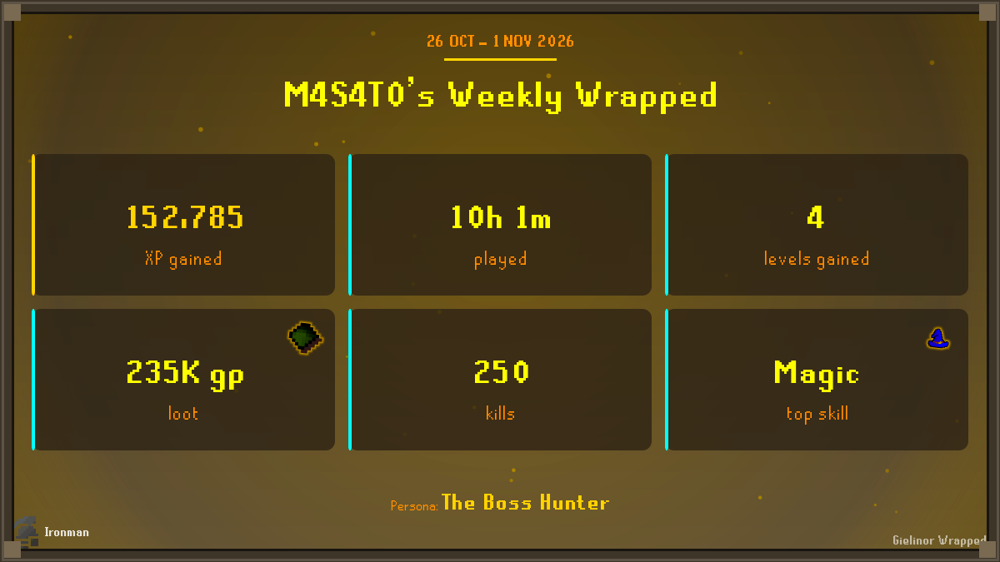
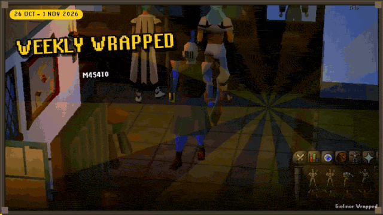
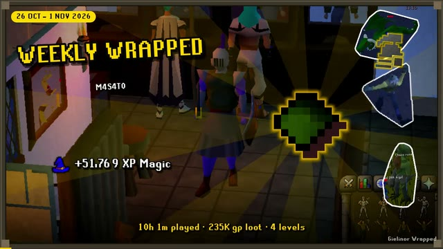
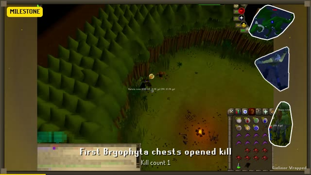
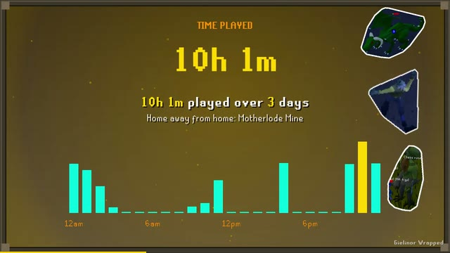
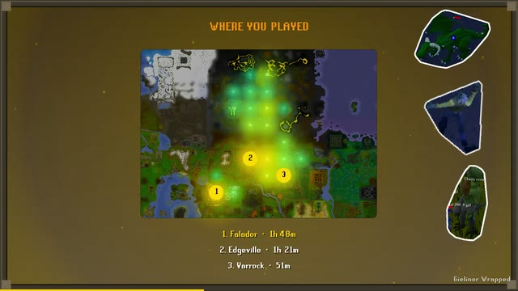
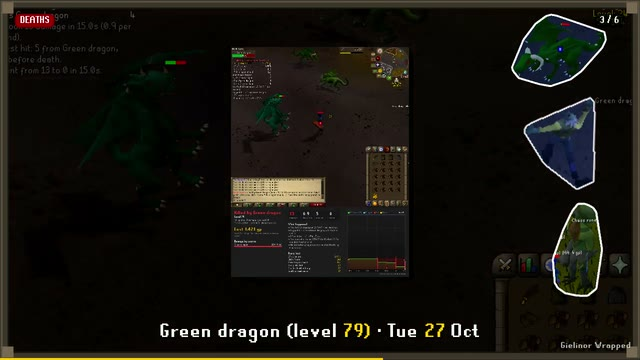
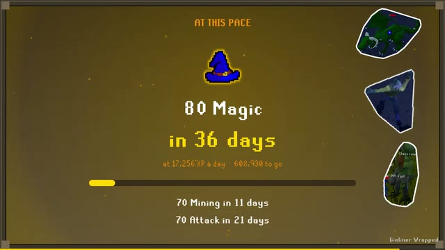
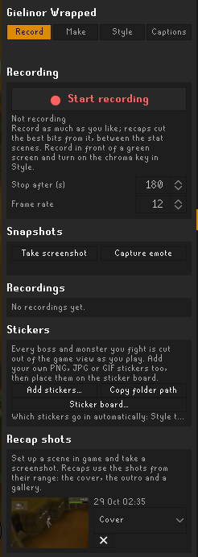
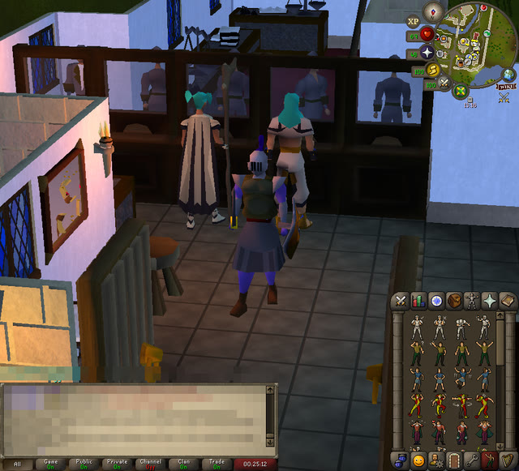

<p align="center">
  
</p>

<h1 align="center">Gielinor Wrapped</h1>

<p align="center">
  <b>Your Old School RuneScape play, wrapped up.</b><br>
  Daily, weekly, monthly, yearly or any range you pick: a share card ready for Discord, Reddit or X,<br>
  and a captioned recap video built from clips of your own gameplay, with game music under it.
</p>

<p align="center">
  
  <br><sub>A real weekly share card, copied to the clipboard with one click.</sub>
</p>

<p align="center">
  
  <br><sub>Highlights from a weekly recap video. <a href="screenshots/recap-week.mp4">Watch the whole 58-second video (MP4, with music)</a>.</sub>
</p>

<table align="center">
  <tr>
    <td align="center"></td>
    <td align="center"></td>
    <td align="center"></td>
  </tr>
  <tr>
    <td align="center"><sub>Splash title over your cover shot</sub></td>
    <td align="center"><sub>Highlight clips, saved as they happen</sub></td>
    <td align="center"><sub>Graphs</sub></td>
  </tr>
  <tr>
    <td align="center"></td>
    <td align="center"></td>
    <td align="center"></td>
  </tr>
  <tr>
    <td align="center"><sub>Where you played</sub></td>
    <td align="center"><sub>Deaths, from <a href="https://github.com/M4S4T0-V01D/death-recap">Death Recap</a></sub></td>
    <td align="center"><sub>Goal pace</sub></td>
  </tr>
</table>

<p align="center">
  Everything is made on your computer. The plugin makes no network requests and uploads nothing.<br>
  Video and music are encoded in plain Java, with no extra downloads.
</p>

---

## Contents

- [What gets tracked](#what-gets-tracked)
- [The side panel](#the-side-panel)
- [Making a recap](#making-a-recap)
- [Death log and Death Recap](#death-log)
- [Extra scenes](#extra-scenes)
- [Customising](#customising)
- [Where files are kept](#where-files-are-kept)
- [Install](#install)

## What gets tracked

- XP and levels gained per skill
- Loot value, your best drops and where they came from
- Kills, deaths, clues and kill-count milestones
- Time played, time per area, your busiest hour and play streaks
- Boss kills, fastest kill times and Slayer tasks
- Collection log slots, Combat Achievement tasks and achievement diary tasks
- Grand Exchange trades: gp bought, sold and your net

Highlight moments are recorded as they happen: big drops, pets, new collection log slots, level ups, personal bests, quests and deaths. With **Record clips** on, the plugin keeps a few seconds of the game window in memory. When a moment happens, it saves a short clip. Press the **clip hotkey** to save the last few seconds yourself.

Clips are scaled down and stored in the plugin's data folder. When they go over the disk space limit, the least important clips are deleted first. **Hide chat in clips** blurs the chatbox and private messages.

## The side panel



Open the gift icon in the sidebar. The panel has four tabs:

- **Record:** start and stop a footage recording, take a screenshot, capture your emote, add stickers, and see your shots and recordings
- **Make:** make recaps and manage the saved ones
- **Style:** theme, card layout, colours, effects, music track and stickers, without opening the settings
- **Captions:** write your own captions

### Recording footage

Press **● Start recording** (or the **Start/stop hotkey**), play, then press **■ Stop**. A recording stops by itself at the **Longest recording** limit. When a video is made, your recordings are chopped into short cuts (**Footage cut length**, up to **Footage cuts** of them). The cuts go between scenes, behind the stat scenes, or both. Recordings use their own disk space limit.

### Your emote

Press **Capture emote**, then do any emote in game. The plugin cuts your character out of the next few seconds of the game view. With **Show my emote** on, it dances on the title and outro. You do the emote yourself; the plugin only records it.

<br clear="right">

### Green screen

Recorded yourself in front of a green or blue screen? Turn on **Green screen (chroma key)** and pick the **Key colour**. **Key tolerance**, **Key softness** and **Remove colour spill** tune the cut-out. **Keyed footage goes** puts the cut-out of you over your other recordings or over the stat scenes.

### Stickers

Stickers are pictures dropped into the video scenes, with an optional **Wobble**:

- **Boss & NPC cutouts:** the NPC cut out of your kill and drop clips
- **Game icon stickers:** skill, prayer and other game icons on the stat scenes
- **Ironman badge:** on Ironman, Ultimate, Hardcore and Group Ironman accounts, your chat helmet goes on the title and outro as a sticker. It also sits next to your account type in the corner of share cards, and before your name (and your friend's) in friend duels. The plugin reads the account type each time you log in. It keeps the latest one, so a Hardcore who dies shows the plain Ironman helmet from then on.
- **My pictures:** your own PNG, JPG or GIF files (animated GIFs keep playing). Use **Add stickers…** in the panel, or **Copy folder path** and drop files into that folder.

Stickers are placed automatically, or you can place them yourself with **Sticker board…** in the panel. Pick a scene and click a sticker to add it. Drag to move it, scroll to resize it, Shift+scroll to turn it, and right-click or press Delete to remove it. Stickers you place replace the automatic ones on that scene. Turn off **Auto stickers on scenes I leave empty** to keep the other scenes clear.

### Music

MP4 videos can have game music under them. Choose a track from the list in the **Style** tab; it holds every track in the game's music player. You can also pick **Random**, or **Current area** for whatever was playing when you made the recap. The track is read from the game cache and played by a small built-in synthesizer, so it sounds close to the in-game music but not exactly the same. Volume and fades are in the **Music** settings. Music makes the video a little bigger (about 1 MB per minute), and the video quality is adjusted to stay within the size limit.

## Making a recap

In the **Make** tab, pick a range and press **Make recap**:

- Today, yesterday, this or last week, month or year
- A custom range up to a year long

The card takes a moment. The video renders in the background at low priority, with a progress bar and a Cancel button.

Under **Your recaps** you can:

- **Copy** the card to the clipboard
- **Card** saves it as a PNG
- **Video** saves the video
- **+Video** renders a video for a recap that only has a card (with the friend picked under **Friend**, if any)
- **Upload** copies a ready-to-paste title, description and chapter list for YouTube; it is also saved as `upload.txt` next to the video
- **Friend** saves a friend file for this recap (see below)
- **✕** deletes the recap
- Click a thumbnail for a larger preview

### Recap shots

<table align="center">
  <tr>
    <td align="center"></td>
    <td align="center"></td>
  </tr>
  <tr>
    <td align="center"><sub>A shot set up in game, with the chat blurred…</sub></td>
    <td align="center"><sub>…becomes the backdrop of the splash title</sub></td>
  </tr>
</table>

Want a say in how your recap looks? Set up a shot in game, such as your character posing at a boss lair or a fresh outfit, then press **Take screenshot** in the panel. You can also bind **Recap shots → Shot hotkey** in the settings. Under **Recap shots** in the panel, give each shot a role:

- **Cover:** the backdrop of the splash title and the Splash card
- **Outro:** behind the closing card of the video
- **Gallery:** a slideshow scene with a slow pan and a caption for each shot

A recap uses the shots taken from the start of its range until it is made, so you can still set up a cover after the week ends. The newest cover and outro win. Up to 8 gallery shots are used, spread evenly over the range. **Shot area** picks the game view only (the default, which leaves out the side panels and most of the interface) or the whole window. The chatbox and private messages are blurred either way. Shots never move your character or click anything; you set the scene yourself.

### Death log

Every death is logged for good, and the newest ones are listed under **Death log** in the **Make** tab, along with your total deaths and gp lost.

If you also run the **[Death Recap](https://github.com/M4S4T0-V01D/death-recap)** plugin (on the Plugin Hub), it shares each death with Gielinor Wrapped: who killed you, where, the damage taken, the gp lost, its death card, its screenshot and its replay. Turn this on or off with Death Recap's **Share with Gielinor Wrapped** setting, which is on by default. Deaths Death Recap saved before you installed Gielinor Wrapped are sent across the next time you log in. Plugins can't read each other's files, so the two plugins pass deaths to each other in RuneLite instead. Nothing leaves your computer.

A recap's video gets a **Deaths** scene that plays your Death Recap cards one after another over the death screenshot, with a caption under each. A death that wasn't clipped uses Death Recap's replay as its highlight clip instead. These options are in the **Death log** settings:

- **Deaths scene:** turns the scene on or off
- **Deaths shown:** above this, the costliest deaths are kept
- **Death captions:** tokens `{killer}` `{place}` `{gpLost}` `{damage}` `{world}` `{date}` `{time}` `{player}`
- **Use replays:** saves Death Recap's replay GIFs so they can be used as clips

### Extra scenes

Videos can include these scenes, each with an on/off switch under **Extra scenes** in the settings:

- **Where you played:** the whole OSRS world map, Kourend and Varlamore included, with a glow where you spent your time and your top three places
- **Graphs:** bar charts of XP, time played and loot by day (recaps up to a month), week (up to six months) or month, or by hour for a one-day recap
- **Vs last time:** this period next to the one before it, also as the **Vs last time** card layout
- **Goal pace:** how long your next big goal takes at this rate, e.g. "99 Mining in 41 days"
- **Bosses & Slayer:** your top bosses with their cutouts, kill counts and fastest kills, and Slayer tasks done
- **Collection log:** new slots as an icon grid, with Combat Achievement and diary tasks
- **Grand Exchange:** gp bought and sold, your net and your biggest trades. The **GE receipt** card uses the real trades when there are any.
- **Year in review:** for recaps longer than two months, the best clip from each month
- **Friend duel:** you vs a friend, side by side

A scene is left out when there is nothing to show, and the extras are among the first scenes dropped when a video runs long.

### Friend duels

Press **Friend** on a recap to save a `.gwfriend` file and send it to a friend however you like. When they send theirs back, press **Import** next to **Friend** in the **Make** tab, pick it, then make a video with them selected. A friend file holds only totals (XP, loot, kills, time, top skill and so on) and the name shown on the recap; with **Hide my name** on it says "Adventurer". Nothing is sent anywhere by the plugin. **✕** next to the list forgets the selected friend.

### Scheduled recaps

Under **Schedule**, turn on daily, weekly, monthly or yearly recaps. Each one is made once, the first time you log in after the period ends, and only if you played during it. **Chat notification** tells you in chat when it's ready.

## Customising

Everything is in the plugin's settings:

- **Video:** format (MP4 or GIF), shape (landscape, square, or vertical for TikTok, Shorts and Reels), resolution, frame rate, maximum length, size limit (50 MB by default; set 10 to fit Discord's free tier), number of clips, pace (relaxed, normal or snappy), which scenes to include, progress bar and cinema bars.
- **Transitions:** Cut, Fade, Slide, Zoom, Wipe, Pixelate, Flash, Iris, Spin or Mixed, with an adjustable length.
- **Captions:** on/off, style (Boxed, Outlined, Drop shadow, or Word by word karaoke), position, size, and the text of every scene. **My captions** (one per line, also editable in the **Captions** tab) are shown as caption cards between scenes.
- **Look:** 15 themes (Gielinor, Midnight, Neon, Wilderness, Clean light, Rune, Dragon, Barrows, Ancient, Desert, Fremennik frost, Vaporwave, Noir, Retro 2007, Toxic), or **Custom colours** with your own background, text and accents. You can also pick a font, background effect (motes, stars, embers, synth grid, soft blobs, snow), colour grade (warm, cool, vintage, sepia, black & white, vivid, dreamy), vignette, film grain, scanlines and a frame border.
- **Share card layouts:** Summary, Top fives, Highlight moment, Minimal, Splash, Poster, Hiscores table, Quest scroll, GE receipt and Vs last time. Splash is a YouTube-thumbnail style card: sun rays, big outlined text and your best items blown up with a glow.
- **Item and skill icons:** real game sprites next to drops, skills, level ups and highlight clips, on cards and in videos.
- **Title style:** Splash (the thumbnail look, over your cover shot or your best clip) or Classic.
- **Recap shots:** shot hotkey, shot area, the gallery scene, and whether the cover is used as the backdrop.

When a recap would run over the maximum length, clips are trimmed first. After that the least important scenes are dropped.

### Caption tokens

Caption text can contain `{tokens}` that are filled in for each recap:

| Token | Meaning |
|---|---|
| `{player}` | Your name |
| `{period}` | "Weekly", "Monthly", … (the dates for custom ranges) |
| `{periodNoun}` | "week", "month", … |
| `{range}`, `{dates}` | The dates covered, e.g. "19 Oct – 25 Oct 2026" |
| `{xp}` | Total XP gained |
| `{xpChange}` | XP compared with the period before, e.g. "+12%" |
| `{topSkill}`, `{topSkillXp}` | Skill with the most XP and how much |
| `{levels}` | Levels gained |
| `{loot}` | Total loot value |
| `{topDrop}`, `{topDropValue}`, `{topSource}` | Best drop, its value, and the best-paying source |
| `{kills}`, `{topKill}`, `{topKillCount}` | Kills in total, most-killed monster and how many |
| `{deaths}`, `{clues}` | Deaths and clues completed |
| `{hours}` | Time played |
| `{days}` | Days played |
| `{active}` | Time spent actively playing, not idle |
| `{streak}` | Longest run of days in a row |
| `{peakHour}`, `{busiestDay}` | When you play most |
| `{topArea}` | Where you spent the most time |
| `{highlights}` | Number of highlight moments |
| `{accountType}` | "Ironman", "Hardcore Ironman" and so on; empty for normal accounts |
| `{persona}`, `{personaBlurb}` | Your playful title for the period and its line |

Clip captions use the moment's own tokens: `{title}`, `{detail}`, `{value}`, `{date}` and `{time}`. Gallery captions can use `{date}`, `{time}` and `{player}`. The splash headline ("{period} Wrapped" by default) can use any recap token.

## Where files are kept

Everything lives in `.runelite/plugin-data/gielinor-wrapped/accounts/<account>/`:

- `days/`: daily stats as JSON
- `clips/`, `timelapse/`: highlight clips and timelapse stills
- `shots/`: your recap shots; the role is part of the file name
- `footage/`, `emote.gwc`: footage recordings and your captured emote
- `stickers/`: your own sticker pictures
- `deaths/`: the death log (`deaths.json`), plus the cards, screenshots and replays from Death Recap
- `recaps/<period>/`: `card.png`, the video, `upload.txt` and `recap.json`
- `friends/`: imported friend files

Delete a folder to forget it.

## Install

Gielinor Wrapped is waiting for review on the RuneLite Plugin Hub. Once it's accepted, open the **Plugin Hub** in RuneLite's configuration panel, search for **Gielinor Wrapped** and press **Install**.

To try it before then, build it from source:

```
./gradlew test   # unit tests; the video tests use ffprobe if installed
./gradlew run    # starts RuneLite in developer mode with the plugin loaded
```

Needs Java 11 or newer. There are no dependencies beyond RuneLite itself.

## Your data

- Nothing is sent anywhere. The plugin makes no network requests, and your recaps leave your computer only if you share them.
- The chatbox and private messages are blurred in clips, recordings and shots (**Hide chat in clips**, on by default).
- The plugin only watches and records. It never moves your character, clicks or types anything.
- Friend files hold totals only, and **Hide my name** swaps your name for "Adventurer".

## Credits

The world map in the "Where you played" scene is stitched from the map tiles rendered from the game cache by [mejrs/layers_osrs](https://github.com/mejrs/layers_osrs), which are also used by the OSRS Wiki's map. Old School RuneScape and its map are © Jagex Ltd.

## License

BSD 2-Clause. See [LICENSE](LICENSE).
